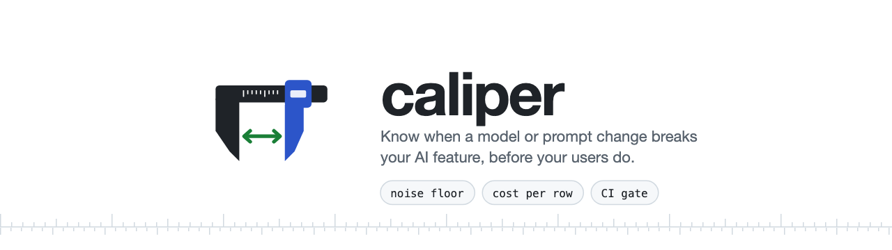
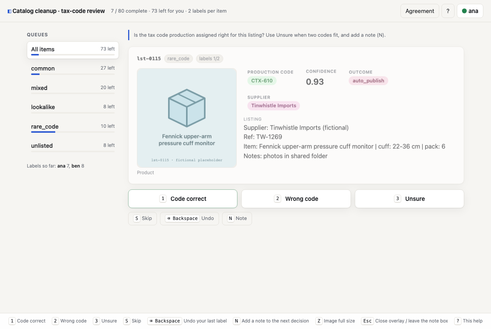
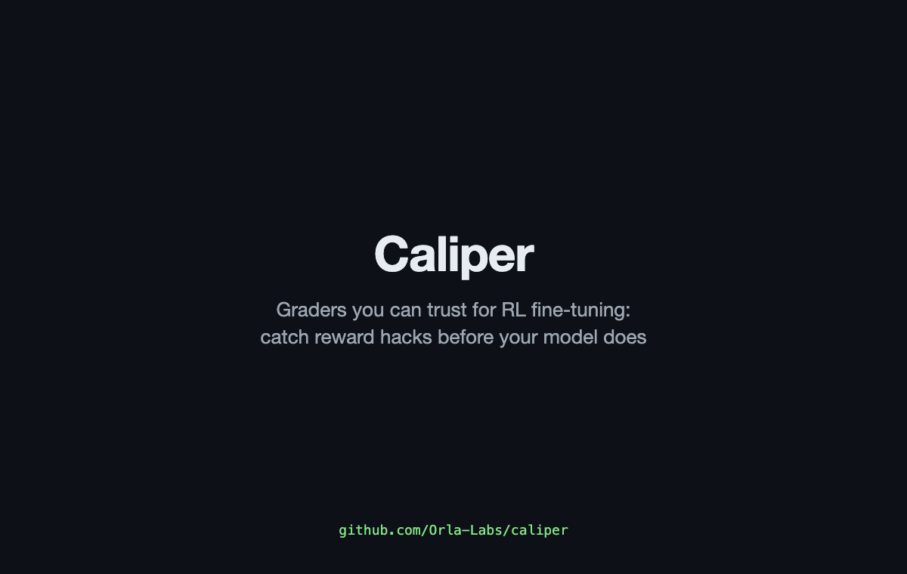

<p align="center">
  <picture>
    <source media="(prefers-color-scheme: dark)" srcset="docs/brand/caliper-hero-dark.png">
    
  </picture>
</p>

# Caliper

**Know when a model or prompt change breaks your AI feature, before your users do.**

[](./LICENSE)
[](./pyproject.toml)
[](#run-the-tests)

Caliper is for teams shipping an LLM feature on a frontier API: classification, extraction, judging, scoring. These teams change prompts and models often. Before each change, `caliper eval` replays a golden set of real requests through the candidates. It applies your feature's own decision logic and tells you what the feature would do differently, what it would cost per call and per month, and whether the difference is larger than the noise you already live with. In CI it posts the verdict on the pull request and fails the build when a change regresses.

## Why it works this way

- **Grade the system outcome, not single replies.** Features wrap the model in vote loops, thresholds and fallbacks. You give Caliper your feature's `decide(replies) -> outcome`, and `assert_parity` proves that mirror matches the production rule over every reply sequence from a representative alphabet.
- **Noise floor first.** The reference model is replayed twice. A candidate's changed outcomes only count above the reference's own replay-flip rate. "Matches the incumbent" is a paired bootstrap of the per-row difference, not two separate intervals.
- **Cost-weighted transitions.** Every changed outcome is a transition (`auto_publish -> needs_review`). Each one carries the cost you assign, because a record that skips review is worse than one that gets an extra look.
- **A candidate is model + thinking + output mode.** A preflight fails fast when a provider rejects a request shape. Every result records which model actually answered, so a silent fallback fails the gate instead of passing it.
- **Calibration against human approvals.** If your feature emits a confidence score and people review some outputs, Caliper sweeps the auto-accept threshold on `val`. It recommends the lowest one that reaches your target precision and reports it on `test`.
- **Know who labelled what.** Every label carries its source. Agreement with an LLM teacher is reported as teacher agreement, never as accuracy. Hard cases get named slice gates of their own.
- **Cost is part of the verdict.** Every reply is priced from the provider's own published prices where one exists (live AWS Price List for Bedrock, by region and inference tier). The report shows cost per row against the incumbent and, given your traffic, dollars per month. `[ci] max_cost_ratio` fails a change that costs too much, and a reply with no known price fails it too instead of reading as free.
- **Practical plumbing.** It replays the request exactly as stored, enforces a budget guard, keeps results resumable, and has a stratified sampler that builds golden sets from production logs without losing the rare cases.

## Quickstart

Needs [uv](https://docs.astral.sh/uv/) ≥ 0.11.

```bash
uv sync

# The whole story on a synthetic example, offline, no API keys, byte-for-byte deterministic:
# golden set -> preflight -> noise floor -> slices -> matched operating point -> calibration -> CI verdict.
scripts/demo_eval.sh
scripts/demo_eval.sh --check      # diff against examples/catalog_cleanup/expected_output.txt

# Run the eval yourself
uv run caliper eval --config examples/catalog_cleanup/caliper.toml \
    --out build/catalog-eval --ci --summary-md build/catalog-eval/summary.md

# Build a golden set from production logs, keeping rare outcomes whole
uv run caliper sample --in examples/catalog_cleanup/logs.jsonl --out build/golden.jsonl \
    --stratum-field outcome --keep needs_review,fallback --negatives 40 --id-field id
```

The example ([`examples/catalog_cleanup`](examples/catalog_cleanup/README.md)) is a fictional marketplace feature. An LLM fills product-catalog records (description, specs, a tax-category code) with a confidence score, and low scores go to a person. On the fake provider, the demo shows these synthetic results:

- The baseline's noise floor is 1 flip in 80 rows.
- A cheaper model sends 19 auto-published records to review, mostly rare product families. Its cost-weighted regression is 0.300, which is 0.263 [0.163, 0.362] above the baseline's own noise (paired), so the gate fails.
- The same cheap model with thinking on is non-inferior overall (paired excess 0.013 [-0.087, 0.087]), but it is not cheaper: its thinking tokens bring it to 1.04x the baseline's cost per row (+$87/month at 20,000 calls a day). CI still blocks it, because on test it loses one record in the `rare_code` must-not-lose slice that the current model handles.
- Calibration picks the auto-publish threshold on the validation split: 0.70, at 95.2% precision on 28 reviewer-labelled rows. On test the same threshold gives 85.7% precision on reviewer labels, plus 75.0% *teacher agreement* on the LLM-labelled rows, reported separately.

Every number comes from the simulation, not from a real system. [`caliper.real.toml`](examples/catalog_cleanup/caliper.real.toml) runs the same golden set on Claude models and an OpenAI-compatible endpoint when you have keys.

To use it on your own feature, write three files:

1. `golden.jsonl`, rows holding the exact requests your feature sent.
2. `decide.py`, your feature's routing logic.
3. `caliper.toml`, the candidates, costs and gate.

[docs/eval.md](docs/eval.md) has the concepts, the config reference and the CLI reference.

### Trust the labels you grade against

Every label in a golden set can say who produced it (`label_source`: an end user, an internal reviewer, an LLM teacher, a heuristic). Caliper reports every label-based number per source. Agreement with human labels is precision. Agreement with an LLM teacher is reported as *teacher agreement*, never as accuracy, and a report with no human-labelled rows says so and asks for some ([label provenance](docs/eval.md#label-provenance-truth-vs-teacher-agreement)).

- **Selection hygiene.** Thresholds are picked on `val` and reported on `test`. Every test touch is written to a ledger, so re-checking the same candidate on test fails CI unless you pass `--allow-test-retouch` ([details](docs/eval.md#selection-hygiene-pick-on-val-report-on-test-touch-test-once)).
- **Matched operating point.** A candidate is compared with the incumbent at the same coverage (the same share auto-handled), counting the rows each side gets wrong ([details](docs/eval.md#matched-operating-point)).
- **Paired bootstrap.** The "matches or beats the incumbent" verdict uses a paired bootstrap of the per-row difference, net of the incumbent's own replay noise ([CI gate](docs/eval.md#ci-gate)).
- **Named slice gates.** `[[slices]]` give hard cases their own rule: `must_not_lose` (zero rows lost vs the incumbent), `max_regression` or `min_precision`. Each failing slice is its own CI failure reason ([details](docs/eval.md#named-slice-gates)).

## In CI

```yaml
# .github/workflows/eval.yml (excerpt)
permissions:
  contents: read
  pull-requests: write

steps:
  - uses: actions/checkout@v4
  - uses: astral-sh/setup-uv@v3
  - run: uv sync --all-extras    # real providers need the [anthropic] extra

  - name: Eval the feature
    run: >
      uv run caliper eval --config evals/caliper.toml --out build/eval
      --ci --summary-md build/eval/summary.md
    env:
      ANTHROPIC_API_KEY: ${{ secrets.ANTHROPIC_API_KEY }}

  - name: Post the summary on the PR
    if: always() && github.event_name == 'pull_request'
    run: |
      cat build/eval/summary.md >> "$GITHUB_STEP_SUMMARY"
      gh pr comment ${{ github.event.pull_request.number }} --body-file build/eval/summary.md
    env:
      GH_TOKEN: ${{ github.token }}
```

`--ci` exits 1 when any candidate's paired excess over the noise floor can exceed `[ci].max_regression` (upper bound of its 95% CI, by default), fails a named slice, costs more than `[ci].max_cost_ratio` times the reference per row (or has no known price), errors more than `[ci].max_error_rate`, was answered by a different model than requested, or touches the test split again without `--allow-test-retouch`. `budget_usd` caps what one run can spend. A stopped run resumes from `results.jsonl`.

## Label your data: `caliper label`



`caliper label serve golden.jsonl --config label.yaml` opens a local, keyboard-first labelling UI with no accounts and no build step. It shows one item at a time as a card with text, badges, numbers, links and images (`Z` for full size), takes a single key per decision, and offers skip, undo and notes. A sidebar splits the set into named queues with progress. Several people can label at once, and every label records who and when in an append-only log. With `double_label: 2` each item needs two labellers, and the agreement view shows inter-annotator kappa overall and by category. `caliper label export` writes golden rows with `label` / `label_approved` filled in for `caliper eval` calibration, or labeled rollouts ready for `caliper_kappa`. Disagreements are left out and listed, never silently resolved.

```bash
# Try it on the example (80 fictional catalog cards)
uv run caliper label serve examples/catalog_cleanup/golden.jsonl \
    --config examples/catalog_cleanup/label.yaml

# Inter-rater agreement from the label log, overall and by category. This needs items
# labelled by two or more people: set `double_label: 2` in label.yaml first.
uv run caliper kappa --labels build/labels/golden.labels.jsonl --by category
```

`caliper kappa --labels` uses Cohen's kappa when exactly two people labelled the overlap items and Fleiss' kappa when three or more did. Undone and skipped labels are dropped, and an LLM teacher's labels are left out unless you pass `--source all`. Categories where kappa is undefined (for example, everyone chose the same label) are flagged, not shown as a number. See [docs/label.md](docs/label.md).

## Advanced: train against the same grader

If you go further and fine-tune with reinforcement learning (RFT), the grader *is* the objective. The policy is optimized against whatever the grader actually rewards, not what you meant it to reward. A grader that checks "is the gold answer somewhere in the response?" also pays full reward for listing three candidate numbers, for a bare number with no working, or for `1161.69` when the answer is `161.69`. Caliper treats the grader as code under test:

- **Mutation testing.** Eight built-in adversarial edits (hardcode the gold answer, truncate, corrupt the answer, add sycophancy, ...) each declare how a robust grader's score should move. Mutations that survive are reward hacks waiting to happen.
- **Classification-grader mutations (opt-in).** For graders of verdict + rationale outputs, five degenerate classifiers: a constant answer, the majority class, a keyword-match verdict, a rationale that argues the other label, and a hedge that names every label. A grader that only checks "is the gold label in the verdict?" lets all five through. `scripts/smoke_mutate_classification.py` shows a naive grader with 5 survivors next to a robust one with 0.
- **Agreement with humans.** Cohen's kappa against a small labeled set, next to a surface-feature baseline, so you know whether the grader agrees with people for the right reasons. `caliper kappa --rollouts LABELED.jsonl --grader FILE.py:ATTR` prints it from the command line.
- **One grader, several trainers.** The same `@grader` function compiles to a self-contained reward module for TRL or Amazon Bedrock RFT.



On the bundled example (`examples/invoice_totals`, 46 human-labeled answers), the naive grader lets 2 mutations survive and has kappa 0.389. The fixed grader kills every applicable mutation and reaches kappa 0.868. `scripts/demo.sh` reproduces those numbers byte for byte.

```bash
# dataset -> mutation tests -> kappa -> compile to TRL; offline, deterministic
scripts/demo.sh
scripts/demo.sh --check        # diff against demo/expected_output.txt

# Compile a grader for your trainer
uv run caliper-compile --target trl \
    --grader examples/invoice_totals/graders.py:fixed_grader \
    --dataset examples/invoice_totals/prompts.jsonl \
    --out build/trl
```

### Supported targets

`caliper-compile` turns the grader you debugged in Caliper into the reward function your trainer runs. It also exports your prompts and gold answers as that trainer's dataset. Each emitted reward file is self-contained: it holds your grader's source plus a small standard-library copy of `grader`/`Rollout`/`GraderResult`, so it runs on a TRL training box or in AWS Lambda without Caliper or pydantic installed. Output is deterministic, so you can diff and review it like code. See [docs/targets.md](docs/targets.md).

| Target | Trainer | Emits | Status |
|---|---|---|---|
| `trl` | Hugging Face TRL `GRPOTrainer` (any open-weight model) | `train.jsonl` (conversational `prompt` + `gold`), `reward_funcs.py` | Supported |
| `bedrock` | Amazon Bedrock reinforcement fine-tuning (Nova 2 Lite, gpt-oss-20B, Qwen3 32B) | `train.jsonl` (`messages` + `reference_answer`), `lambda_function.py` | Supported |
| `openai` | OpenAI reinforcement fine-tuning | `rft_job.json` (python grader), `train.jsonl` | Legacy / deprecated: [OpenAI is winding down fine-tuning](https://developers.openai.com/api/docs/deprecations) |

### Editor and dry-run server

Needs Node 20+ with pnpm.

```bash
pnpm --dir packages/editor install
./scripts/dev.sh
# editor: http://localhost:3456
# server: http://localhost:8000
```

Open the editor, edit the sample grader, click **Dry run**: see the histogram, top/bottom rows, and any failures. Append `?evalSet=<name>` to the editor URL to dry-run against another eval set in the server's store. Or in pieces: `uv run caliper-server --port 8000` and `pnpm --dir packages/editor dev`.

## Built by

Caliper is built by [Orla Labs](https://orlalabs.com).

## Layout

```
.
├── packages/
│   ├── eval/         caliper eval / sample / kappa: candidates, providers, noise floor,
│   │                 paired gate, transitions, calibration, label provenance,
│   │                 val/test ledger, slice gates, matched operating point,
│   │                 sampler                                                   (Python)
│   ├── sdk/          @grader decorator, Runner, typed records, source loader   (Python)
│   ├── store/        versioned content-addressed eval-set storage (SQLite/PG)  (Python)
│   ├── rft_compile/  caliper-compile: grader -> TRL / Bedrock / OpenAI (legacy) (Python)
│   ├── differ/       v1 vs v2 grader diff on an eval set                       (Python)
│   ├── monitor/      reward-hack auxiliary judges (4 built-in rubrics)         (Python)
│   ├── mutate/       mutation testing for graders (8 built-ins + 5 opt-in
│   │                 classification mutations)                                 (Python)
│   ├── kappa/        Cohen's κ grader vs labels; inter-rater κ by category     (Python)
│   ├── label/        caliper label: local keyboard-first labelling UI         (Python)
│   ├── server/       FastAPI dry-run backend + pluggable executor (in-proc/E2B)(Python)
│   └── editor/       Monaco-based grader IDE                                   (Next.js)
├── examples/
│   ├── catalog_cleanup/  synthetic LLM feature: logs, golden set, decide + parity test,
│   │                     fake models, offline and real-provider configs
│   └── invoice_totals/   golden dataset, human labels, naive/fixed/baseline graders
├── demo/
│   ├── run_demo.py         the deterministic RFT-grader demo (scripts/demo.sh)
│   ├── expected_output.txt its byte-exact transcript
│   └── record/             re-records docs/demo.gif (Playwright + ffmpeg)
├── docs/
│   ├── eval.md             caliper eval: concepts, config and CLI reference
│   ├── label.md            caliper label: config, keys, double labelling, export
│   ├── label.png
│   ├── demo.gif
│   └── targets.md          per-target details for caliper-compile
└── scripts/
    ├── demo_eval.sh                runs the catalog_cleanup eval demo; --check diffs its transcript
    ├── demo.sh                     runs demo/run_demo.py; --check diffs against the transcript
    ├── dev.sh                      starts server (:8000) + editor (:3456) together
    ├── smoke_eval.py               caliper eval end to end: report shape, resume, preflight, sampler,
    │                               test ledger, provenance, slices
    ├── smoke_label.py              caliper label end to end
    ├── smoke_dry_run.py            POSTs sample grader → /dry-run, asserts shape
    ├── smoke_mutation_test.py      runs all 8 mutations against robust + naked-gold graders
    ├── smoke_mutate_classification.py  5 classification mutations: naive vs robust classifier grader
    ├── smoke_kappa_tracking.py     legal grader vs hand-built labels; prints unweighted/linear/quadratic κ
    ├── smoke_compile_targets.py    caliper-compile for trl/bedrock/openai; runs each artifact in `python -I -S`
    ├── smoke_rft_passthrough.py    legacy OpenAI path: compile → submit → poll via FakeRFTClient
    └── smoke_e2b_sandbox.py        live smoke for E2BExecutor; skips without E2B_API_KEY
```

## Run the tests

```bash
uv sync
uv run pytest -q              # 561 tests
uv run ruff check packages examples
```

## Smokes

Self-contained end-to-end checks. No network, no API keys (one optional smoke skips cleanly without `E2B_API_KEY`).

```bash
uv run python scripts/smoke_eval.py
scripts/demo_eval.sh --check
uv run python scripts/smoke_label.py
uv run python scripts/smoke_dry_run.py
uv run python scripts/smoke_mutation_test.py
uv run python scripts/smoke_mutate_classification.py
uv run python scripts/smoke_kappa_tracking.py
uv run python scripts/smoke_compile_targets.py
uv run python scripts/smoke_rft_passthrough.py    # legacy OpenAI path
uv run python scripts/smoke_e2b_sandbox.py        # SKIPs without E2B_API_KEY
scripts/demo.sh --check
```

## What's interesting in here

- **Feature-level eval** (`packages/eval/`): replays golden requests through candidates (fake, Anthropic direct, Bedrock, OpenAI-compatible). It grades the outcome of your own `decide()` and proves that mirror with `assert_parity`. It measures a bootstrap noise floor before calling anything a regression, gates on a paired bootstrap, weights transitions by cost, and records who answered each request. Labels carry provenance (teacher agreement is never called accuracy), thresholds are picked on val with a test-touch ledger, and named slices and a matched-operating-point comparison catch losses an average hides. The CI gate and markdown summary are designed to be posted on PRs.
- **Mutation testing for graders** (`packages/mutate/`): 8 built-in mutations (drop-format-gate, wrong-answer, truncate, whitespace-perturb, prepend-sycophancy, append-garbage, case-perturb, hardcode-gold) plus a rank-order CI gate. Surfaces graders that pass on the surface but accept reward-hacked outputs. An opt-in set of 5 classification mutations (`classification_mutations(labels, ...)`) targets verdict + rationale graders.
- **κ tracking** (`packages/kappa/`): unweighted / linear-weighted / quadratic-weighted κ between a grader and a labeled reference set, with an explicit `kappa_undefined` flag for the math-undefined cases. `inter_rater_kappa` measures labeller-vs-labeller agreement overall and by category: Cohen's κ for two raters, Fleiss' κ for three or more (rotating pairs allowed), plus per-pair κ. Pure stdlib + Pydantic. `caliper eval` reuses it for threshold calibration, and `caliper kappa` exposes both from the CLI.
- **Pluggable grader executor** (`packages/server/src/caliper_server/executor.py`): `InProcessExecutor` for offline tests; `E2BExecutor` runs grader source inside a Firecracker microVM with the workspace SDK shipped in as a wheel. Selected via `CALIPER_GRADER_EXECUTOR=in_process|e2b`.
- **Versioned content-addressed eval-set storage** (`packages/store/`): `EvalSetStore` Protocol, two backends (`InMemoryStore` + `SqlStore` via SQLAlchemy 2.x over SQLite or Postgres), 12-char SHA-256 content hashes, idempotent `create()`. Selected via `CALIPER_STORE_URL`.
- **Compile to trainers** (`packages/rft_compile/`): `caliper-compile` emits a self-contained reward module plus dataset for TRL `GRPOTrainer` or an AWS Lambda for Amazon Bedrock RFT, byte-identical across runs. The legacy OpenAI path (`method.type=reinforcement` JSON, `RFTRunner` + `OpenAIRFTClient` with mocked-SDK tests) is kept for existing users while OpenAI winds down fine-tuning.

## Stack

- Python ≥ 3.12, uv workspace, ruff, pytest with `--import-mode=importlib`
- TypeScript / pnpm / Next.js 15 (app router) / React 19 / `@monaco-editor/react`
- Pydantic v2 for all typed records
- SQLAlchemy 2.x for the eval-set store; `e2b-code-interpreter` as an optional `[e2b]` extra; `anthropic` as optional `[anthropic]` / `[bedrock]` extras for `caliper-eval`

## License

[Apache-2.0](./LICENSE).
