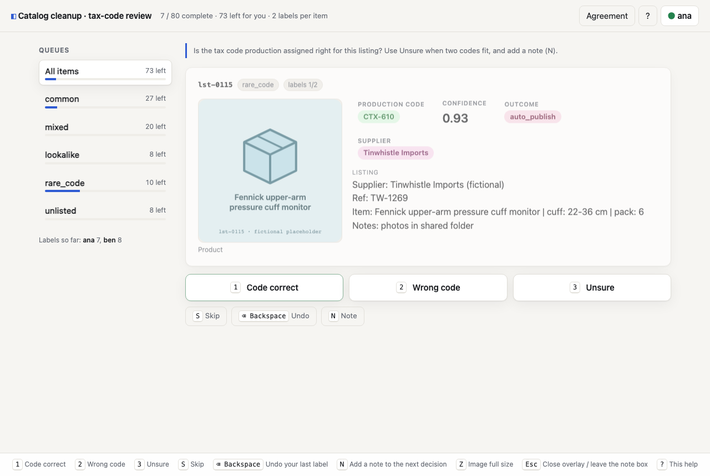

# `caliper label`

`caliper label` is a local, keyboard-first labelling tool. It shows one item at a
time as a card, records a decision with a single key (or a click or tap), and keeps
every label in an append-only log. A *project* reads its items from wherever they
live (CSV, Parquet, a folder of images, S3, Postgres, ...). Exports go straight into
`caliper eval` and `caliper kappa`, or out as CSV, JSONL, Parquet, a database table
or an S3 object. It runs as one process on your machine, and the data never leaves it.
Team mode is the same server on a shared host, behind an access token.



```bash
uv run caliper label                 # start screen: new project / open project / try the demo
uv run caliper label ./my-project    # straight into a project
```

- Setting up a project (the wizard, `caliper.label.yaml`, settings): [label-setup.md](label-setup.md)
- Data sources, credentials and writing your own connector: [label-connectors.md](label-connectors.md)
- This page: [labelling](#labelling), [keyboard](#keyboard), [label types](#label-types),
  [golden checks](#golden-checks), [several labellers](#several-labellers),
  [team mode](#team-mode), [dashboard](#dashboard), [adjudication](#adjudication),
  [export](#export), [script it](#script-it-the-rest-api), [CLI](#cli-reference),
  [legacy `serve`](#legacy-serve-datajsonl---config-labelyaml)

## Labelling

1. **Name.** On the first visit the page asks who is labelling. The name is kept
   in this browser and recorded on every label. Click the name in the top bar to
   change it.
2. **Queue.** The queue list splits the project by `workflow.queues.by` (for example
   the sampler's `stratum`). Each queue shows a progress bar and how many items are
   left for you. "All items" walks every queue. Your choice is remembered, and
   `#/label?queue=NAME` links straight to one queue.
3. **Card.** Text, long text, numbers, badges, links, JSON and images, as designed
   in the project. Click an image or press `Z` to see it full size. Decision keys
   still work while it is open, and it stays open on the next card.
4. **Decide.** One key per option, or click or tap it. The next card appears at
   once: the next five cards and their images are already loaded, and the label
   is saved in the background, in order. If a save fails, the card comes back with
   the reason.
5. **Skip / undo / note.** Skip puts the item behind everything else; it comes back,
   marked "skipped earlier", when nothing else is left. Undo retracts your last
   label or skip and brings that item back. A note (`N`) goes with the next
   decision.
6. **Done.** When a queue runs out you see "Queue … is done" with the other queues
   that still have work. When everything is done you see "All done", with links to
   the dashboard and the export.

Every screen has designed loading, empty and error states. Errors say how to fix
them (for example, "no project open: open a project from the start screen").
Screen readers get labels on every decision ("Code correct (key 1)") and a polite
live region that says what was saved and what is next. Focus is always visible, and
colours meet WCAG AA in light and dark mode. Laptop: a queue sidebar. Tablet
(1024 px and below): queues across the top and larger buttons. Phone: decision
buttons stick to the bottom of the screen.

**Speed.** Deciding swaps to the next card from memory. Measured in Chromium with
`packages/label/e2e/label_e2e.mjs` over 30 keyboard decisions on the catalog
example, from keypress to the next card painted: p50 about 12 ms, p95 about 24 ms.
The target is under 100 ms. On a 1M-item project, `GET /api/next?n=6` takes about
1 to 16 ms on the server.

## Keyboard

| key | action |
| --- | --- |
| option hotkeys (`1`..`9`, or whatever the project sets) | label the card and move on (multi-choice: toggle) |
| `Enter` | multi-choice: save the selection; score / free text: save |
| `/` | score / free text: jump into the answer box |
| `S` | skip (`labels.keys.skip`) |
| `Backspace` | undo your last label or skip (`labels.keys.undo`) |
| `N` | note for the next decision; `Enter` or `Esc` returns to the keys (`labels.keys.note`) |
| `Z` | image full size; `Z` again or `Esc` closes |
| `Esc` | close an overlay, or leave a text box |
| `?` | shortcut overlay |

Shortcuts are off while a text box has focus. A bar along the bottom lists them all
(hidden on phones). Adjudication uses the option hotkeys too, with `J` / `K` for the
next and previous item.

## Label types

`labels.type` in `caliper.label.yaml`. `LabelRecord.decision` is a string, so every
type has one stored form:

| type | how you decide | stored `decision` | `human_label` in rollouts |
| --- | --- | --- | --- |
| `single` (default) | one key or button per option | the option `value` | option `score`, else 1 if `approved`, else 0 |
| `yes_no_unsure` | Yes `1` / No `2` / Unsure `3` (default options) | `yes` / `no` / `unsure` | as single (Yes is approved) |
| `multi` | hotkeys toggle, `Enter` saves | JSON array of values, sorted: `["damaged", "late"]` | the highest of the chosen options |
| `score` | one button per value (`1`..`5`), or a number box | the number as text: `"4"`, `"2.5"` | (value − min) / (max − min) |
| `free_text` | type, `Enter` saves (`Shift+Enter` new line) | the trimmed text | none; rollouts and kappa do not apply |

Options without a hotkey get `1`..`9` automatically. An option with
`requires_note: true` opens the note box when you choose it, and the server
refuses it without a note (422, with a hint). Options marked `retired` in settings
are hidden and refused for new labels. Labels that already use them are kept and
show up in exports and the dashboard.

## Golden checks

With `workflow.golden: {answer_column: known, rate: 0.05}`, rows with a value in
`known` are hidden known-answer items. They are mixed into each labeller's stream
at the given rate. Each labeller sees each one once, and where they appear is
drawn from an RNG seeded per labeller, so their position doesn't give them away.
The answer column is never sent to the browser. A card looks the same as any other
card, with no label counts on it. The answer may name an option by value, label or
outcome, case-insensitive. For multi-choice, list several (`a,b` or a JSON array).

The dashboard shows each labeller's accuracy on them. Golden items are a test,
not data: they are left out of kappa, the progress counts and every export.

## Several labellers

Several people can label at once against one server. While a card is on someone's
screen, or in their prefetch queue, it is leased to them for 10 minutes, so two
people are not shown the same item when it needs only one more label.

- **`workflow.double_label: N`.** Each item needs labels from N different people.
  Nobody is served an item they already labelled. Items someone else has already
  labelled come first, so the overlap set fills early.
- **`workflow.assignment: open`** (default). Everyone works from the same queue in
  data order.
- **`workflow.assignment: round_robin`.** Each labeller gets a fixed share of the
  items:
  - people join the rotation in the order they first ask for work (or first appear
    in the label log);
  - item number *k* goes to labeller *k mod n*, and with double labelling to the
    next `double_label − 1` labellers too;
  - when someone new joins, the shares of the not-yet-labelled items are dealt
    again, and labels already given stay where they are;
  - with no more labellers than `double_label`, everyone sees everything.

## Team mode

```bash
uv run caliper label ./my-project --host 0.0.0.0 --auth token
# team mode: share this link (it carries the access token): http://127.0.0.1:8765/?token=...
```

- **The token.** It is generated at startup, or taken from `CALIPER_LABEL_TOKEN`, and
  printed once in the share link. It is never logged after that:
  - uvicorn's access log is off;
  - any `token=` or `Bearer …` in a uvicorn log line is redacted.
- **Sending it.** Every `/api` request needs it, except `/api/status`. Accepted forms:
  - the header `Authorization: Bearer <token>` (scripts);
  - `?token=<token>` (the share link);
  - the `caliper_label_token` cookie. The server sets it (HttpOnly, SameSite=Strict) the
    first time a header or link token checks out, so images and downloads work too.
- **In the browser.** The page keeps the token and removes `?token=` from the
  address bar.
- **Checking.** The token is compared in constant time. A missing or wrong token gets
  401 `{"detail": "access token required" | "wrong access token", "hint": ...}`. The
  page then shows an "Access token needed" screen where the token can be pasted.
- **Names.** Each labeller types a name. Nothing verifies it: one token is shared.
  SSO and roles are Phase 2.
- **Setup stays on the server machine.** In team mode these routes answer only
  requests from the machine running `caliper label` (loopback); everyone else gets
  403 with a hint:
  - `/api/source/*`, `/api/setup/*`, `/api/projects*`;
  - saving settings;
  - `POST /api/export`, which writes files, S3 objects or tables with the server's
    credentials.

  Labelling, the dashboard, adjudication and downloads work for everyone. Behind a
  reverse proxy every request looks local, so block those paths at the proxy.

## Dashboard

`#/dashboard` (or `GET /api/dashboard`) refreshes every 20 seconds:

- **Totals:** items complete, labels, κ, and disagreements left to adjudicate.
- **Per labeller:**
  - labels;
  - labels in the last hour;
  - throughput in labels per hour of *active* time (a pause over 5 minutes counts as a break; shown after a minute of work);
  - skips;
  - golden accuracy;
  - last label.
- **Per queue:** complete / total and labels in the last hour.
- **Agreement:** inter-annotator κ overall and by `labels.category_column`, with the
  share of items where everyone agrees. κ comes from
  `caliper_eval.inter_rater.inter_rater_from_records`: Cohen's for exactly two
  raters on the overlap set, Fleiss' for three or more. Only human votes count.
  LLM-teacher labels, adjudications and golden items are left out. When κ is
  undefined (for example, every label is the same) it is shown as "–" with the
  reason, never as a misleading 0. Free text has no κ.
- **Disagreements:** the first 50, with who said what, linking to adjudication.

## Adjudication

`#/adjudicate` lists items with two or more votes that differ.

- **Layout.** The card is on the left. Each labeller's label, note and time are side
  by side on the right.
- **Setting the final label.** The adjudicator picks it with a click or the option
  hotkey and can add a note.
- **What gets stored.** A `LabelRecord` with `source: adjudicated`, where `labeller`
  is the adjudicator.
- **Effect on votes.** None:
  - the adjudicator's own vote, if any, stays as it was;
  - the adjudication never counts towards `double_label` or κ;
  - Undo (`Backspace`) cannot retract it.
- **Changing it.** A later adjudication of the same item replaces it.
- **Tabs.** "To decide", "Decided", "All".

## Export

From `#/export` or the CLI. Every export uses the same consensus:

| situation | result |
| --- | --- |
| an adjudicated final label | that label, always (`status: adjudicated`) |
| no labels | left out (`unlabelled`) |
| fewer than `double_label` votes | left out (`incomplete`) |
| votes agree | that label (`agreed`, or `single` with one label per item) |
| votes disagree, `--conflicts exclude` (default) | left out (`conflict`) |
| votes disagree, `--conflicts majority` | strict majority wins (`majority`); ties are left out |

The conflict policy is always an explicit choice. The CLI summary and the export
screen count each group and list every item left out, with who said what.

| format | what | for |
| --- | --- | --- |
| `golden` | GoldenRow JSONL; only `label`, `label_approved`, `label_source`, `label_stage` and `metadata.labelling` change (with `project_version`) | `caliper eval` |
| `rollouts` | EvalRow JSONL with `rollout.metadata.human_label` (0..1) plus provenance and `project_version` | `caliper kappa`, `caliper_kappa.compute_kappa` |
| `records` | the raw `LabelRecord` log: every label, skip, undo and adjudication. Kept as pure `LabelRecord`, so `load_label_records` and `caliper kappa --labels` read it; the project version is in the other formats | your own analysis |
| `csv`, `jsonl`, `parquet` | the label table: one row per item with its final label (`--rows items`, default), or one row per label (`--rows labels`) | spreadsheets, notebooks, BI |
| `table` | the label table written back to a table in the project's database (created if missing, otherwise appended) | the system the data came from |

**Provenance.** Every label-table row carries `labeller`, `labelled_at`, `note`,
`source`, `stage` and `project_version`:

- `source` says what kind of labeller made the label. It is the project's `workflow.source`
  (default `internal_reviewer`; also `human_end_user`, `llm_teacher`, `heuristic`), or
  `adjudicated` when an adjudicator set the final label. It is not the data source.
- `labeller` is `;`-joined when several people agreed;
- the adjudicator is named for adjudicated items;
- the item's own columns follow: flat `item.<column>` columns in CSV, Parquet and tables,
  and one nested `"item": {...}` object in JSON lines, where the card's JSON columns are
  real objects (CSV/Parquet/tables keep them as JSON text).

`retired_option` is `true` when the label's option was retired in Settings after the label
was made. Such labels are kept (and still exported), and this column flags them. `GET /api/labels` records
carry the same `retired_option` field. Golden and rollouts exports are unchanged.

`approved` and `human_label` are only in the table when they mean something: the project
has an option with `approved: true`, an option with a `score`, or the `score` label type.
In the table, an option that abstains (value or label `unsure`, `uncertain`, `unknown`,
`maybe`, ...) with no `score` of its own gets `approved: null, human_label: null`, not the
0 a wrong answer gets. Give it a `score` (for example 0.5) to export a number instead.
Golden and rollouts exports are unchanged: there Unsure still counts as not approved, 0.

An example row (`--format jsonl`, an adjudicated item):

```json
{"item_id": "t1", "queue": "low", "category": "shipping", "label": "wrong", "label_display": "Wrong",
 "approved": false, "human_label": 0, "status": "adjudicated", "n_labels": 2,
 "labeller": "lee", "labelled_at": "2026-11-06T22:13:42.543800Z", "note": "billing owns refunds",
 "source": "adjudicated", "stage": "triage", "project_version": 3,
 "item": {"ticket_id": "t1", "subject": "Fictional ticket 1", "team": "shipping",
          "meta": {"channel": "email"}}}
```

**Times are UTC.** `labelled_at` is UTC ISO 8601 with a `Z`, and file names use the same clock:
`<project>-<format>-<UTC time>Z.<ext>`, for example `tickets-jsonl-20261106-223600Z.jsonl`.
Only the labeller's screen shows local time.

**Column order.** The item's columns come in card order (the order set in the wizard or in
Settings → Card), then the columns the card doesn't show (hidden fields, the id, the rest of the
source row).

`project_version` is the config `revision`, bumped on every settings save, so you
can tell which labels were made under which options.

```bash
caliper label export ./my-project --format csv --out labels.csv
caliper label export ./my-project --format rollouts --out rollouts.jsonl --conflicts majority
caliper label export ./my-project --format parquet --out s3://bucket/labels/labels.parquet [--overwrite]
caliper label export ./my-project --format table --table triage_labels
```

Parquet, S3 and table exports go through the same connectors and credential rules
as data sources ([label-connectors.md](label-connectors.md)). From the UI, file
exports are written inside the project folder (default `exports/`).
**Download** works from any machine, including in team mode.

## Script it: the REST API

The server documents its API at **`/docs`** (OpenAPI; the raw schema is at
`/openapi.json`). Every error is `{"detail": "...", "hint": "..."}`.

```bash
B=http://127.0.0.1:8765
H="Authorization: Bearer $CALIPER_LABEL_TOKEN"     # team mode only

# list items (paginated), one item
curl -s -H "$H" "$B/api/items?offset=0&limit=50&queue=high"
curl -s -H "$H" "$B/api/items/t42"

# what should ana label next? (n up to 20; leases them to ana)
curl -s -H "$H" "$B/api/next?labeller=ana&n=5"

# post a label (multi: a list; score: a number; free text: the text)
curl -s -H "$H" -H 'Content-Type: application/json' -X POST "$B/api/labels" \
  -d '{"item_id": "t42", "labeller": "ana", "decision": "wrong", "note": "refund, not shipping"}'

# skip, undo
curl -s -H "$H" -H 'Content-Type: application/json' -X POST "$B/api/labels" \
  -d '{"item_id": "t43", "labeller": "ana", "skip": true}'
curl -s -H "$H" -H 'Content-Type: application/json' -X POST "$B/api/undo" -d '{"labeller": "ana"}'

# fetch labels (active ones; all=true for the raw log incl. skips, undos, adjudications)
curl -s -H "$H" "$B/api/labels?labeller=ana&offset=0&limit=500"

# progress, adjudication, export
curl -s -H "$H" "$B/api/dashboard"
curl -s -H "$H" -H 'Content-Type: application/json' -X POST "$B/api/adjudications" \
  -d '{"item_id": "t7", "adjudicator": "lee", "decision": "correct"}'
curl -s -H "$H" -o labels.csv "$B/api/export/download?format=csv&conflicts=exclude"
```

| status | when |
| --- | --- |
| 400 | unknown or retired option, empty answer, score off the scale |
| 401 | team mode, missing or wrong token |
| 403 | team mode, a setup or server-side export route from another machine |
| 404 | unknown item or queue |
| 409 | this labeller already labelled the item (undo first), or no project is open |
| 422 | a required note is missing, or the request body is malformed |

## CLI reference

```
caliper label [PROJECT_DIR] [--host 127.0.0.1] [--port 8765] [--auth token|none] [--no-browser]
caliper label init ...                                   # headless project creation (label-setup.md)
caliper label export [PROJECT_DIR] --format golden|rollouts|records|csv|jsonl|parquet|table
                     (--out FILE|s3://... | --table NAME) [--rows items|labels]
                     [--conflicts exclude|majority] [--include-unlabelled] [--overwrite]
caliper label serve DATA.jsonl --config label.yaml [--labeller NAME] [--store labels.jsonl|.sqlite]
                    [--host ...] [--port ...] [--auth token|none] [--no-browser]   # legacy
caliper label export --data DATA.jsonl --config label.yaml --out OUT.jsonl
                     [--store ...] [--format golden|rollouts|records]               # legacy
```

With no folder you get the start screen; with a folder, that project. The first open takes
the snapshot of the source; later opens label from the snapshot even if the source
is unreachable. Exit codes: 0 ok, 2 usage, config or connection error, which is
printed as one line plus a `fix:` line.

`scripts/smoke_label.py` runs both paths offline:
- the legacy loop on the catalog example;
- a team-mode project over a CSV snapshot, with three fictional labellers, a golden check, adjudication, a CSV export, and rollouts fed into `compute_kappa`.

`packages/label/e2e/label_e2e.mjs` is the browser check. It covers the loop, latency,
the dashboard, adjudication, export, and tablet and phone layouts. It needs
`playwright-core` (set `PLAYWRIGHT_CORE`) and skips cleanly without it:

```bash
PLAYWRIGHT_CORE=/path/to/node_modules/playwright-core node packages/label/e2e/label_e2e.mjs --port 8788
```

## Legacy: `serve DATA.jsonl --config label.yaml`

The original file-based mode still works, unchanged. It uses the same UI and API
(including `/docs`), and keeps its old endpoints (`/api/label`, `/api/item/{id}`,
`/api/config`, `/api/image/{id}/{n}`) for existing scripts.

```bash
uv run caliper label serve examples/catalog_cleanup/golden.jsonl \
    --config examples/catalog_cleanup/label.yaml
```

Labels go to `build/labels/golden.labels.jsonl` unless you pass `--store`.

### Input data

`serve` and `export` take one JSONL file. Its kind is detected from the rows:

| every row has | kind | item id | notes |
| --- | --- | --- | --- |
| `request` (object) and valid as `GoldenRow` | Caliper `GoldenRow` | `id` | `export --format golden` available. Rows with a `request` that are not GoldenRows (e.g. production logs) are labelled as plain rows, with a notice |
| `rollout` (object) | `EvalRow` (`caliper_sdk`) | `id` | rollouts export keeps the rollout and adds `human_label` |
| anything else | plain rows | `id_key` (default `id`), else `row-0000`, `row-0001`, ... | |

Ids must be unique. Labels refer to items by id, so you can re-sort or extend
the data file and keep labelling. Labels for ids that are no longer in the file
are kept in the log and reported at startup.

### Config reference

YAML (`label.yaml`) or TOML (`label.toml`), same keys. The catalog example:

```yaml
title: Catalog cleanup · tax-code review
instructions: Is the tax code production assigned right for this listing? ...

fields:
  - {template: "cards/{id}.svg", type: image, label: Product}
  - {key: metadata.production_tax_code, type: badge, label: Production code}
  - {key: metadata.production_score, type: number, decimals: 2, label: Confidence}
  - {key: reference_outcome, type: badge, label: Outcome}
  - {key: request.messages.-1.content, type: text, label: Listing}

decisions:
  - {key: "1", value: correct, label: Code correct, approved: true, outcome: auto_publish}
  - {key: "2", value: wrong, label: Wrong code, outcome: needs_review}
  - {key: "3", value: unsure, label: Unsure, outcome: needs_review}

keys: {skip: s, undo: backspace, note: n}
queue_key: stratum
category_key: metadata.production_tax_code
source: internal_reviewer
stage: tax_code_review
double_label: 1

rollout:
  prompt: request.messages.-1.content
  response: metadata.production_tax_code
```

| key | default | meaning |
| --- | --- | --- |
| `title`, `instructions` | | shown at the top of the page |
| `id_key` | `id` | dotted path to the item id (plain rows) |
| `fields` | required | what the card shows, in order (below) |
| `decisions` | required | one entry per decision (below) |
| `approved` | `[]` | decision values that mean "approved"; same as `approved: true` on the decision |
| `keys.skip` / `keys.undo` / `keys.note` | `s` / `backspace` / `n` | one character, or `backspace`, `delete` |
| `queue_key` | none (one queue, `all`) | dotted path whose value names the queue |
| `category_key` | none | dotted path whose value is the category for kappa by category |
| `source` | `internal_reviewer` | `LabelSource` recorded on every label: `human_end_user`, `internal_reviewer`, `llm_teacher`, `heuristic` |
| `stage` | none | free-form `LabelRecord.stage` / `GoldenRow.label_stage`, e.g. `triage` |
| `double_label` | 1 | labels from distinct people each item needs (1 to 10) |
| `image_root` | data file's folder | where local image paths resolve (relative to the data file) |
| `rollout.prompt` / `.response` / `.gold` | see [Export](#export) | dotted paths used to build a `Rollout` from non-EvalRow input |

**Paths** are dotted: `metadata.supplier`. Integer parts index lists, and
negative ones count from the end: `request.messages.-1.content` is the last
message.

**Fields** take either `key` (a dotted path) or `template` (a string with
`{dotted.path}` placeholders, e.g. `cards/{id}.svg`), plus:

| `type` | renders | extra keys |
| --- | --- | --- |
| `text` (default) | wrapped text, whitespace kept; objects as pretty JSON | `mono: true` for code |
| `badge` | a coloured pill (colour derived from the value) | |
| `number` | a large tabular number | `decimals` |
| `link` | a link that opens in a new tab; only `http(s)` values are clickable | |
| `image` | a thumbnail; click or `Z` for full size | |

`label` names the field on the card (default: the key). Missing values show
as a dash.

**Images** are either `http(s)` URLs, which the browser loads directly, or
paths relative to `image_root`. The browser never sends a path: it asks for
`/api/image/<item>/<field number>`, and the server resolves that field for that
item. The resolved file must be inside `image_root` (checked after resolving
`..` and symlinks) and have an image extension (`png`, `jpg`, `jpeg`, `gif`,
`webp`, `svg`, `avif`). Otherwise the server answers 403. SVGs are served with
a sandboxing `Content-Security-Policy`.

**Decisions**:

| key | meaning |
| --- | --- |
| `key` | the single key, e.g. `"1"` or `t` (quote digits in YAML to be safe) |
| `value` | what is stored in `LabelRecord.decision`; unique |
| `label` | button text (default: `value`) |
| `approved` | the person approved the output: `GoldenRow.label_approved`, and `human_label` 1 |
| `score` | `human_label` in rollouts exports, 0 to 1 (default 1 if approved, else 0) |
| `outcome` | `GoldenRow.label` on golden export (default: `value`) |

YAML 1.1 reads bare `yes`, `no`, `on` and `off` as booleans. A decision value
written that way is rejected with a hint to quote it.

### Storage

The default store is a JSONL file of `LabelRecord`s
(`caliper_eval.types.LabelRecord`), one per line:

```json
{"item_id": "lst-0003", "decision": "wrong", "skipped": false, "labeller": "ana",
 "source": "internal_reviewer", "stage": "tax_code_review",
 "labelled_at": "2026-11-06T14:02:11.482913Z", "queue": "common",
 "category": "CTX-100", "note": "two codes fit", "undoes": null,
 "record_id": "7f3c0d9e5b1a2c4d6e8f0a1b"}
```

- **Append-only.** Records are never rewritten. Each write is flushed and fsynced
  before the next card appears, so a crash loses at most the label being
  written. A torn last line (an interrupted write, never acknowledged) is
  ignored when reading and trimmed when `serve` reopens the store, with a notice.
  `export` only reads, so it is safe to run while `serve` is up.
- **Undo** appends a record with `decision: null` and `undoes: <record_id>`.
- **Skip** appends a record with `skipped: true` and `decision: null`.
- **Effective labels:** a record is active unless a later record undoes it. Per
  item and labeller, the latest active record wins. Skips never count as labels.
- **Default path:** `build/labels/<data file stem>.labels.jsonl`, outside the
  data folder. Restarting `serve` with the same store picks up where you left
  off.
- **SQLite:** pass `--store labels.sqlite` (or `.db`) to keep the same records in
  one SQLite table (WAL, synchronous writes). It behaves the same way.

### Legacy export

```bash
uv run caliper label export --data examples/catalog_cleanup/golden.jsonl \
    --config examples/catalog_cleanup/label.yaml --out build/golden.labelled.jsonl
```

**Consensus.** Each item resolves from its active labels:

| situation | result |
| --- | --- |
| no labels | left out (`unlabelled`) |
| fewer than `double_label` labels | left out (`incomplete`) |
| all labels agree | resolved to that decision |
| labels disagree, `--conflicts exclude` (default) | left out (`conflict`) |
| labels disagree, `--conflicts majority` | strict majority wins; ties are left out |

The summary on stdout counts each group, and every item left out is listed on
stderr with who said what. Nothing is dropped silently. Resolve conflicts by
discussing them and having one labeller undo, or by adding a third label and
exporting with `--conflicts majority`.

**`--format golden`** (GoldenRow input only). Each resolved row is written back
unchanged except for:

- `label`: the decision's `outcome` (or its `value`);
- `label_approved`: whether the decision is approved;
- `label_source`, `label_stage`: from the records;
- `metadata.labelling`: `human_decision`, `labellers`, `labelled_at`, `notes`.

The file loads with `caliper eval`'s golden loader and feeds its calibration
(`label_approved`). `--include-unlabelled` also writes the rows without a
resolved label, untouched.

**`--format rollouts`** writes `EvalRow` JSONL with
`rollout.metadata.human_label`, the same shape as
[`examples/invoice_totals/labeled_rollouts.jsonl`](../examples/invoice_totals/labeled_rollouts.jsonl).
It works with `caliper_kappa.compute_kappa` and calibration with no conversion:

```python
labels = LabelSet(name="human", rows=[
    LabeledRow(row_id=r.id, label_score=float(r.rollout.metadata["human_label"])) for r in rows])
```

`human_label` is the decision's `score`: 1 when approved, 0 otherwise, unless
the decision sets its own score. Integers are written as `1` and `0`.
`metadata` also carries `human_decision`, `labellers`, `label_source`,
`label_stage`, `labelled_at` and `notes`. A score of 0.5 lands in the "pass"
bucket under `compute_kappa`'s default bins (`[0, 0.5, 1]`). If you give
"unsure" a score of 0.5, pass three-bucket edges such as `[0, 0.25, 0.75, 1]`.

For EvalRow input the rollout is kept as is. For other input the rollout is
built from `rollout.prompt` / `rollout.response` / `rollout.gold` paths. The
default prompt is the request rendered as `[system]` / `[role]` blocks, and the
default response is `reference_outcome`. The row's `metadata` and `stratum` are
copied into the rollout's metadata.

**`--format records`** writes the raw log (every label, skip and undo), for
`caliper_eval.inter_rater.inter_rater_from_records` or your own analysis.
